# Chetan Biranje

**Security Researcher | Application Security | DevSecOps**

I work on web application and REST API security, vulnerability research, authorization testing, and security automation. My open-source projects explore practical approaches to identifying security weaknesses and integrating security checks into software development workflows.

[Portfolio](https://chetanbiranje.vercel.app) · [LinkedIn](https://www.linkedin.com/in/chetanbiranje) · [Email](mailto:chetanbiranje@proton.me)

## Technical focus

| Area | Focus |
| --- | --- |
| Application Security | Web and REST API testing, OWASP, access control, business logic |
| Vulnerability Research | BOLA/IDOR, BFLA, authentication and authorization |
| Security Engineering | STRIDE, OWASP ASVS, secure coding |
| DevSecOps | GitHub Actions, Semgrep, Bandit, Gitleaks, Trivy, OWASP ZAP |
| Automation | Python, REST APIs, n8n, Docker |

## Selected open-source projects

| Project | Focus |
| --- | --- |
| [API Authorization Matrix](https://github.com/Chetan-Biranje/API-Authorization-Matrix-Automated-BOLA-BFLA-Detection) | API authorization testing and BOLA/BFLA detection research |
| [Web Application Pentest Framework](https://github.com/Chetan-Biranje/webapp-pentest-framework) | Structured web application security testing |
| [Automatic DevSecOps Security Workflow](https://github.com/Chetan-Biranje/automatic-DevSecOps-security-workflow) | Automated security checks in development pipelines |
| [Aelira Automation OS](https://github.com/Chetan-Biranje/Aelira-Automation-OS) | AI-optional n8n automation starter; community preview |
| [CodeRaksh](https://github.com/Chetan-Biranje/CodeRaksh-Company) | YouTube transcript API project |
| [Python Security Utilities](https://github.com/Chetan-Biranje/python-security-utilities) | Python-based security tooling |

## Research and engineering notes

- [Web and REST API security research](https://github.com/Chetan-Biranje/web-rest-api-pentest-research)
- [Threat modeling](https://github.com/Chetan-Biranje/threat-modeling-notes)
- [Application security checklists and playbooks](https://github.com/Chetan-Biranje/appsec-checklists-playbooks)
- [Secure coding](https://github.com/Chetan-Biranje/secure-coding-notes)

Security testing should be conducted only on authorized systems. I support responsible disclosure and reproducible security research.

## GitHub activity

[Browse all repositories](https://github.com/Chetan-Biranje?tab=repositories)
